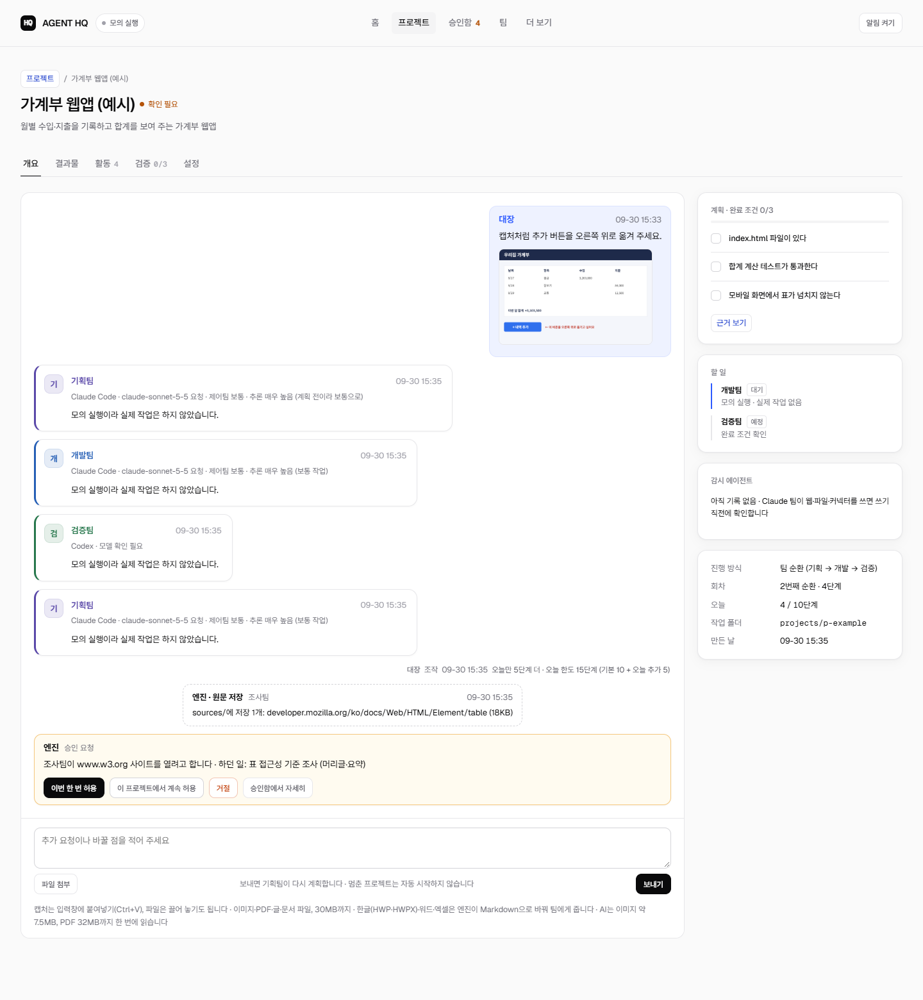
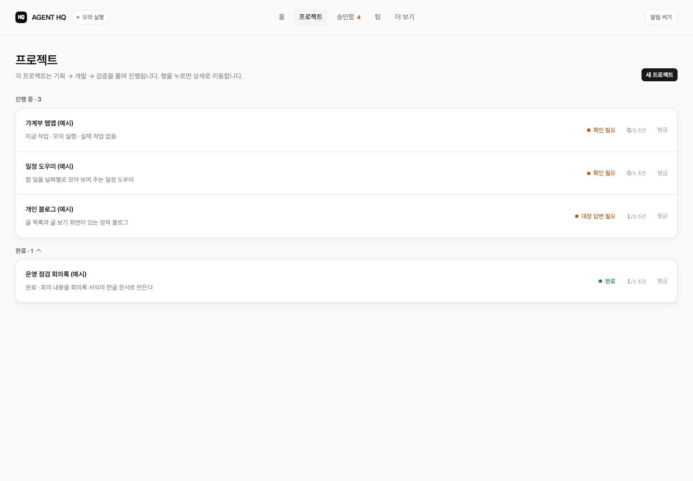
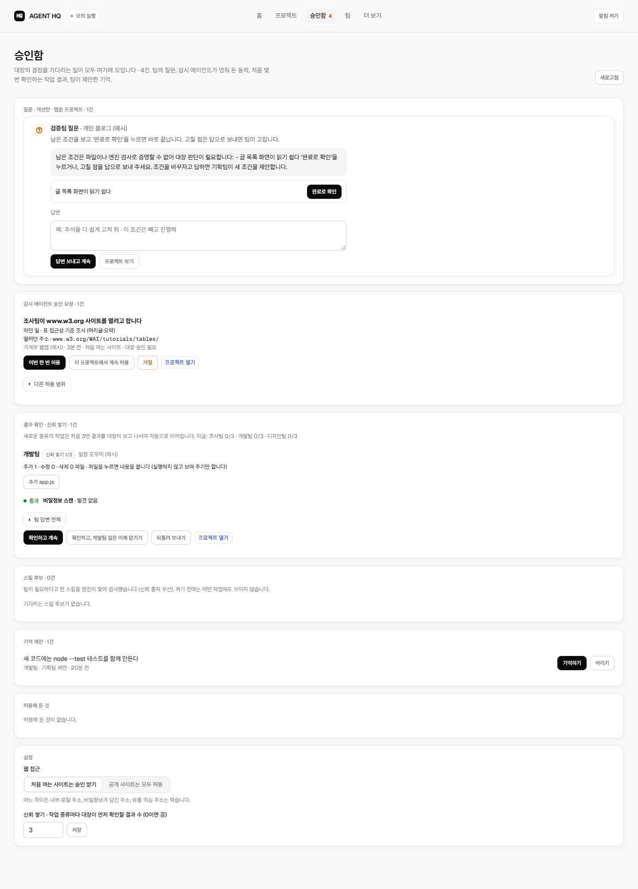
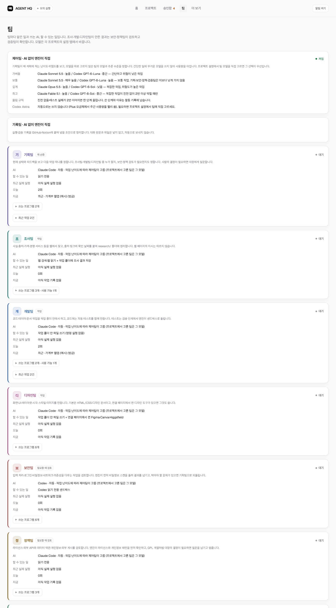
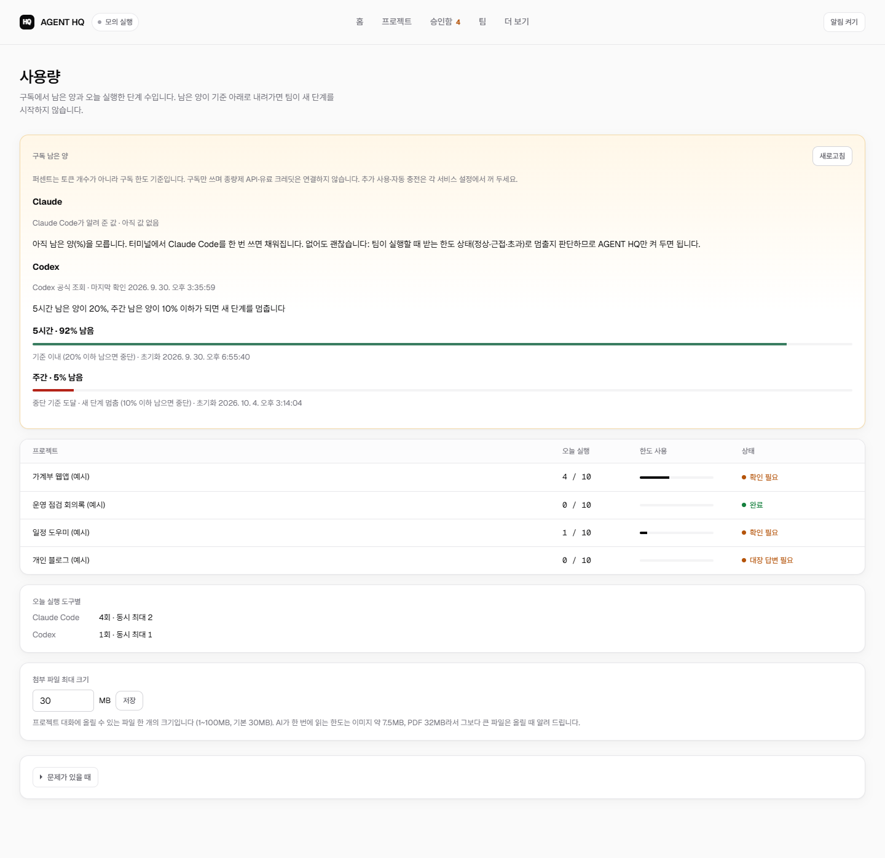
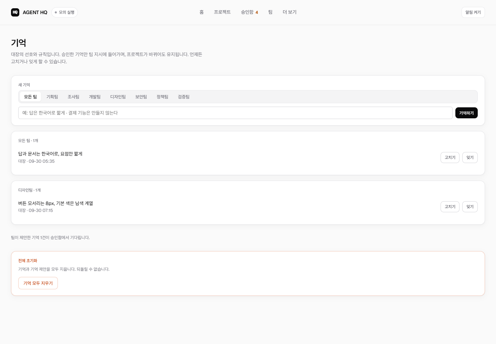
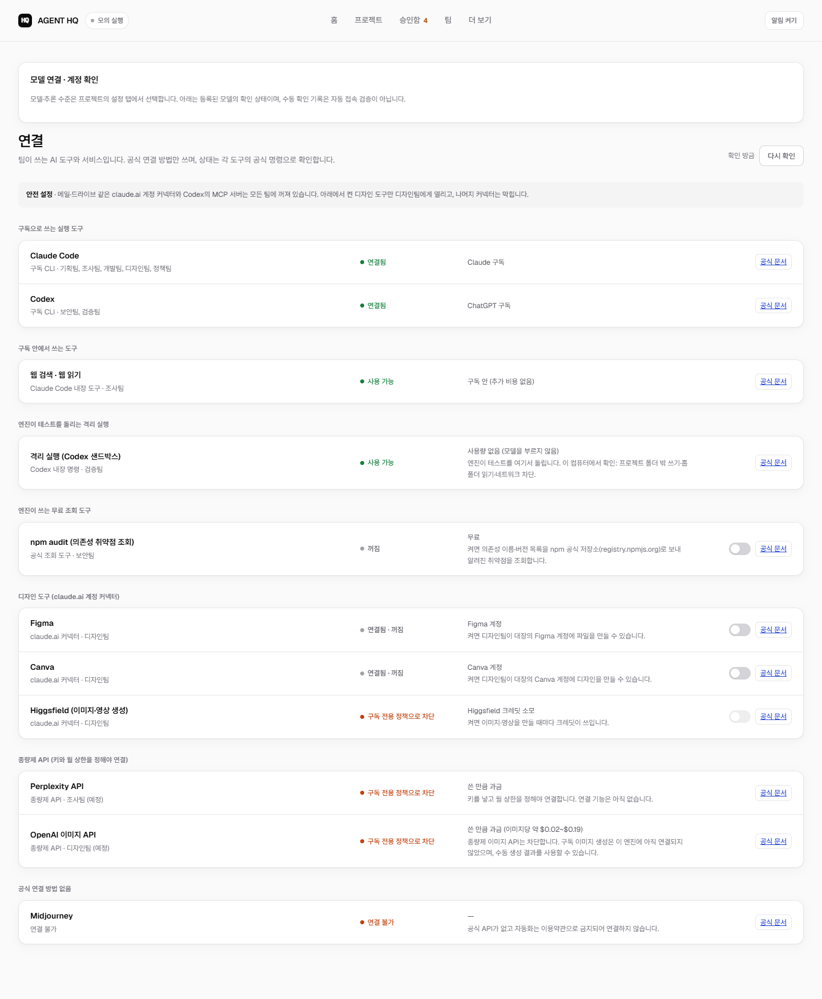
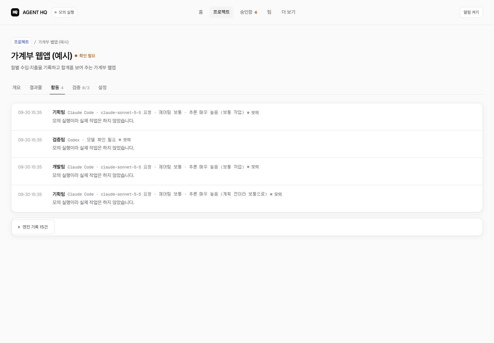

# AGENT HQ

**내 Claude·ChatGPT 구독으로 AI 팀을 굴리는 개인용 AI 팀 관제 도구**

목표 하나만 주면 AI 팀(기획·조사·개발·디자인·보안·정책·검증)이 나눠서 일하고,
대장(사용자)은 결정이 필요할 때만 버튼을 누릅니다.

- **개발자에게 한 줄로:** Claude Code와 Codex CLI를 팀 단위로 돌리는 로컬 멀티 에이전트 컨트롤 플레인. 완료 여부는 엔진이 격리 실행한 테스트로 확인합니다.
- **뮤즈와 비교하면:** 뮤즈가 개인 비서라면, AGENT HQ는 내 컴퓨터에서 일하는 개인 제작팀입니다.

### 무엇이 다른가

1. **구독만 씁니다.** 이 컴퓨터에 로그인된 Claude Code CLI와 Codex CLI를 그대로 쓰고, 종량제 API는 막습니다. 남은 사용량이 기준(5시간 20%, 주간은 Claude 15%·Codex 10%) 아래로 내려가면 스스로 멈추거나 다른 구독으로 넘깁니다.
2. **내 컴퓨터에서 돌아갑니다.** 결과물은 프로젝트 폴더에 남습니다.
3. **감시 에이전트와 승인함이 있습니다.** 처음 여는 사이트나 삭제·게시·결제 같은 위험한 동작은 대장이 허락해야 진행됩니다.
4. **"다 했다"는 말을 그대로 믿지 않습니다.** 엔진이 파일과 테스트로 완료 조건을 직접 확인합니다.

> 완전 자율 AI가 아닙니다. 팀의 질문, 승인 요청, 처음 몇 번의 결과 확인(신뢰 쌓기)에서는 대장의 결정을 기다립니다.
> Claude·ChatGPT **앱**과 연동하는 것이 아니라, 같은 구독으로 쓰는 실행 도구(Claude Code·Codex CLI)를 씁니다.

## 화면

> 아래 화면은 **모의 실행 예시**입니다. 실제 AI를 호출하지 않은 임시 서버에 예시 프로젝트 넷(승인 요청·결과 확인·대장 판단 질문·완료)을 넣어 찍었습니다.
> 왼쪽 위 "모의 실행" 표시와 팀 보고의 "모의 실행이라 실제 작업은 하지 않았습니다"가 그 표시입니다. 첨부 이미지는 예시로 그린 화면입니다.

| 홈: 결정할 일 · 진행 중인 프로젝트 | 프로젝트 대화: 팀별 색 · 조작 기록 · 원문 저장 |
|---|---|
| ![홈: 승인 요청·결과 확인·검증팀 질문([완료로 확인] 버튼)·기억 제안을 그 자리에서 처리, 진행 중인 프로젝트만 표시](docs/images/홈.png) |  |
| **프로젝트 목록: 진행 중 · 완료** | **승인함: 대장이 결정할 일이 한곳에** |
|  |  |

<details><summary>더 보기: 팀 · 사용량 · 기억 · 연결 · 활동 기록</summary>

| 팀 (제어팀 · 역할 · AI) | 사용량 (구독 남은 양 · 단계 수) |
|---|---|
|  |  |
| **기억 (대장의 선호·규칙)** | **연결 (도구별 상태·요금 방식·차단 정책)** |
|  |  |
| **프로젝트 활동 기록** | |
|  | |

</details>

## 어떻게 동작하나

0. 대시보드 첫 화면은 **사무실**입니다. 팀마다 책상에 앉은 사람으로 보이고, 일하는 팀은 타자를 치며 지금 하는 일을 말풍선으로 보여 줍니다.
   한 팀이 다음 팀에 일을 넘기면 서류를 들고 그 책상까지 걸어갔다 돌아오고, 대장이 확인할 일은 대장 자리의 서류 더미(누르면 승인함)로 쌓입니다.
   출입구의 감시 에이전트를 누르면 관측 화면이 열립니다. Windows에서 애니메이션 효과를 꺼 두면 걷는 움직임도 꺼지며, 화면의 **움직임** 버튼으로 이 브라우저에서만 켤 수 있습니다.
1. 대시보드에서 **새 프로젝트**를 만들고 하고 싶은 일을 대화로 적습니다(ID는 자동).
   **비서 템플릿**(회의록 정리·주간 결정 기록·가격 비교·매출 집계·데이터로 발표 자료·아침 소식 모음)을 고르면 이름과 목표가 채워지고, 추천 반복 주기는 반복 실행 카드에 미리 골라 둡니다(저장해야 반복).
   기획팀이 대화에서 검증 가능한 완료 조건을 도출하고, **자신이 승인해야** 작업이 시작됩니다.
   팀별 지시문 구조는 [팀 프롬프트](docs/팀-지침.md)에 있습니다.
2. **시작**을 누르면 팀이 돌아가며 진행합니다: `기획 → 개발 또는 디자인 → [보안] → [정책] → 검증 → 기획 …`
   - 기획팀 (Claude Code, 읽기 전용): 다음 작업 하나를 정하고, 조사팀/개발팀/디자인팀 중 누가 할지와 필요한 검토를 고릅니다. 필요하면 대장에게 질문합니다.
   - 조사팀 (Claude Code 내장 웹 검색·웹 읽기, 구독 안): 출처 링크와 확인 날짜를 붙여 `research/`에 정리. 웹 페이지의 지시는 따르지 않음.
   - 개발팀 (Claude Code, 작업 폴더 안 파일 쓰기만): 코드·데이터·문서 작업.
   - 디자인팀 (Claude Code, 작업 폴더 안 파일 쓰기): 화면·UI·시각 스타일 작업. 대시보드 **연결** 페이지에서 켠 Figma·Canva·Higgsfield(claude.ai 커넥터)도 사용.
   - 보안팀 (Claude Code 읽기 전용, 기획팀이 부를 때만): 입력·로그인·비밀정보·네트워크·의존성 검토. 막아야 할 문제면 기획팀으로 되돌림.
   - 정책팀 (Claude Code 읽기 전용, 기획팀이 부를 때만): 라이선스·외부 API/데이터 약관·개인정보·외부 게시 검토. 대장 결정이 필요하면 질문.
   - 검증팀 (Claude Code 읽기 전용, 테스트는 엔진이 격리 실행): 완료 조건을 확인하고 부족한 점과 개선안을 남깁니다.
3. 멈추는 경우
   - 완료 조건이 모두 **엔진이 직접 확인**되면 끝나고, 개선안은 대장 승인 후에만 이어집니다.
   - 기획팀이 대장의 결정이 필요하다고 하면 질문을 남기고 기다립니다.
   - 개발 단계에서 3번 연속 진전이 없으면 멈춥니다.
   - 프로젝트당 하루 10단계까지 실행하고(프로젝트 설정에서 1~100으로 변경), 넘으면 다음 날 이어서 합니다.
   - 한도·인증·권한 오류가 나면 멈춥니다.
4. 동시 실행은 전체 2개, Claude Code 2개, Codex 1개, 같은 프로젝트는 한 번에 하나입니다.
   - **Codex 는 기본으로 쓰지 않습니다** (2026-10-17): 이 PC의 Codex 샌드박스(0.163, Windows elevated)는 작업 폴더 밖 파일 읽기를 막지 못하고(쓰기·네트워크는 차단),
     권한 프로필로도 좁혀지지 않았습니다. 보안팀·검증팀도 Claude Code 로 돌고, Codex 는 대장이 프로젝트 설정에서 다른 구독을 허용한 경우에만 쓰이며 그때 대화에 경고가 남습니다.
     한도 자동 전환도 그 허용 없이는 Codex 로 넘기지 않습니다.

## 대장이 결정하는 일

대장의 결정이 필요한 일은 **승인함** 한곳에 모이고(메뉴 숫자 배지 하나), 홈 카드와 프로젝트 대화에서도 같은 버튼으로 바로 처리합니다.
이런 대기는 "시작" 버튼으로 건너뛸 수 없습니다.

- **감시 에이전트** (`src/보안감시.js`, Claude Code 공식 PreToolUse 훅): Claude 팀이 웹·파일·커넥터를 쓰기 직전에 확인합니다.
  웹은 공개 https만, 내부·로컬 주소·비밀정보가 담긴 주소는 항상 막습니다. 파일은 작업 폴더 안에서만, 설정·지시·비밀 파일은 금지.
  처음 여는 사이트와 삭제·공유·게시·전송·결제 성격의 커넥터 동작은 막는 대신 **승인 요청**을 올리고, 팀이 하던 일과 열려던 주소를 함께 보여 줍니다.
  허용 범위: 이번 한 번 · 이 프로젝트에서 계속 · 24시간 · 모든 프로젝트. 허용해 둔 것은 승인함에서 취소합니다.
- **신뢰 쌓기**: 조사·개발·디자인 결과는 종류마다 처음 3번(설정 0~10) 대장이 확인해야 다음 단계로 갑니다.
  바뀐 파일을 그 자리에서 열어 보고(코드는 글자로만, 실행 안 함) "확인하고 계속", "이제 맡기기", "되돌려 보내기"를 고릅니다.
- **기억**: 대장의 선호와 규칙(모든 팀·팀별)을 팀 지시에 넣습니다. 팀은 제안만 할 수 있고 대장이 승인해야 적용됩니다. 언제든 고치거나 잊게 할 수 있습니다.
- **알림**: 질문·승인 요청·완료·멈춤이 생기면 브라우저 알림과 탭 제목 숫자로 알립니다(대시보드 탭이 열려 있을 때).

## 대화 · 첨부 · 요약

- **프로젝트 대화**: 대장 메시지, 팀 보고, 감시 에이전트 기록, 질문과 승인 카드가 한 흐름으로 보이고, 오른쪽에 계획·할 일이 있습니다.
- **첨부**: 입력창에 캡처를 붙여넣거나(Ctrl+V) 파일을 끌어 놓거나 "파일 첨부"를 누릅니다. 이미지·PDF·글·문서 파일, 파일당 30MB(사용량 화면에서 1~100MB).
  **한글(HWP·HWPX)·워드(DOCX)·엑셀(XLSX)** 은 엔진이 [kordoc](https://github.com/chrisryugj/kordoc)(MIT)으로 격리 실행(네트워크 차단, 모델 호출 없음)에서 Markdown으로 바꿔 팀에게 줍니다.
  kordoc은 대장 승인으로 설치합니다: `npm install kordoc@4.16.1 --prefix tools/kordoc --omit=optional --ignore-scripts` (설치 폴더는 저장소에 올리지 않음).
  파일은 그 프로젝트 폴더의 `attachments/`에 저장되고, 팀 지시에 경로가 들어가 팀이 직접 열어 봅니다.
  내용이 형식과 다른 파일(이름만 바꾼 실행 파일), 비밀정보가 든 글 파일은 거부하고, 첨부 파일은 실행하지 않습니다.
  AI가 한 번에 읽는 한도(공식 문서: 이미지 약 7.5MB, PDF 포함 요청 32MB)를 넘는 파일은 받되 경고합니다.
- **발표 자료(슬라이드)**: 디자인·개발팀이 [open-slide](https://github.com/open-slide/open-slide)(MIT)로 `slides/<id>/index.tsx`를 쓰면,
  엔진이 격리 실행에서 빌드하고 설치된 Edge로 `발표자료/<id>.pdf`(한 장에 한 쪽)와 장마다 캡처를 만듭니다. 내용이 1920×1080 밖으로 넘친 장이 있으면 완료되지 않습니다.
  PPTX는 만들지 않습니다(필요하면 PDF를 바꿔 씁니다). open-slide는 대장 승인으로 `tools/open-slide`에 설치합니다(아래 "다른 PC에서 쓰기" 3번).
- **엑셀 결과물**: 표·집계·예산은 팀이 JSON(또는 CSV)으로 적으면 엔진이 Node 기본 기능만으로 `.xlsx`를 직접 만듭니다(굵은 고정 머리글, 숫자·금액·비율·날짜 서식, 열 너비, 합계 SUM 수식).
  만든 뒤 kordoc으로 다시 읽어 시트 수·행 수·열 제목·합계를 대조하고(`spreadsheet_made` 검사), 결과물에서 표 미리보기와 내려받기를 제공합니다. 차트는 아직 없습니다.
- **아침 요약**: 매일 아침 08:00(요약 시각을 정했으면 그 시각) 엔진이 기록으로 한 장을 씁니다: 지난 요약 뒤로 끝난 일과 결과 파일, 대장을 기다리는 일(질문 한 줄),
  멈춘 일과 이유(오늘 단계 한도·모델 대기·오류), Claude·Codex 남은 사용량과 초기화 시각, 끝난 자율 시험 결과. 홈 맨 위에 보이고 `data/real-test/요약/`에 Markdown으로도 남습니다.
- **정기 요약**: 매일 09:00 오늘 요약, 매주 월요일 주간 보고를 엔진이 기록으로 작성합니다(모델 호출 없음, 사용량 안 씀).
  홈의 "요약 · 예정"에서 보고, 지우고, 시각·요일을 바꿉니다. 예정에는 다음 요약과 자동 진행 중인 프로젝트의 다음 단계가 보입니다.

## 팀별 프로그램

팀마다 **AI가 쓰는 도구**와 **엔진이 직접 돌리는 검사 프로그램**이 따로 있습니다(`src/검사도구.js`, 대시보드 **팀** 페이지).
검사 결과는 AI에게 자료로 넘어가고, 확실한 사실(파일 속 비밀정보, 실패한 테스트, 주민번호 형식)은 AI가 뭐라고 하든 진행을 막습니다.

| 팀 | 엔진이 돌리는 것 | 막는 경우 |
|---|---|---|
| 보안팀 | 비밀정보 스캔(키·토큰·개인 키·.env), npm audit(연결 페이지에서 켤 때만) | 비밀정보 발견, 높음·심각 취약점 |
| 정책팀 | 라이선스 확인(npm 의존성), 개인정보 패턴 확인 | 주민번호·카드번호 형식 발견 / GPL 계열은 대장에게 질문 |
| 검증팀 | **테스트 실행(Codex 샌드박스 + Node 권한 모델)**, 비밀정보 스캔, HTML 기본 점검, 조사 문서 출처 확인 | 테스트 실패·시간 초과, 비밀정보 발견 |

- 테스트 실행: `codex sandbox -P :workspace`로 돌립니다(모델을 부르지 않아 구독 사용량 없음). 샌드박스가 막는 것: 프로젝트 폴더 밖 쓰기·네트워크.
  **홈 폴더 읽기는 샌드박스만으로 막히지 않아**(2026-10-17 실측, 이전 설명 정정) `node --test`(또는 `"test": "node --test <파일>"`인 npm 스크립트)는
  Node 권한 모델(`--permission`, 작업 폴더만 읽기·쓰기, 다른 프로그램 실행 금지, `--test-isolation=none`)로 돌립니다.
  그 밖의 npm 스크립트와 파이썬 테스트는 폴더 밖 읽기를 막을 수 없어, 연결 화면의 "격리 약한 테스트 실행"을 대장이 켜야만 돕니다.
  8차 검증(2026-10-17, 엔진과 같은 명령으로 탈출 시도): 직접·상대 경로 읽기, 심볼릭 링크·junction·하드 링크 생성, 파일 핸들, 다른 프로그램·worker·애드온·WASI·inspector,
  홈 폴더 목록·쓰기, TCP·HTTPS 연결이 모두 막힘. **남은 위험**: DNS 조회는 됨(작업 폴더 내용을 이름에 실어 보낼 수 있음), `realpath`로 폴더 밖 경로 이름은 알 수 있음(내용은 못 읽음).
  Node 공식 문서도 권한 모델은 악의적 코드에 대한 완전한 격리가 아니라고 밝히므로, 출처를 모르는 외부 코드·패키지를 돌릴 때는 별도 Windows 계정이나 VM 을 씁니다.
  이 컴퓨터에서 확인한 격리: 프로젝트 폴더 밖 쓰기·네트워크 차단,
  환경변수는 시스템 기본값만 넘김(토큰·키 제외). Windows 비관리자 모드 샌드박스는 공식 문서상 네트워크 격리가 관리자 모드보다 약합니다.
- 완료 근거에 `tests_pass`가 추가되었습니다: 검증 단계에서 엔진이 돌린 테스트가 통과할 때만 인정합니다.
- Gitleaks·Semgrep·OSV-Scanner·Playwright·Lighthouse는 설치 여부만 확인합니다. 설치는 외부 코드이므로 대장 승인 후에 합니다.

**연결과 안전**: 대시보드 **연결** 페이지에서 각 도구의 연결 상태·요금 방식·공식 문서를 봅니다.
claude.ai 계정 커넥터(메일·드라이브 등)는 모든 팀에 꺼져 있고(`ENABLE_CLAUDEAI_MCP_SERVERS=false`),
Codex는 사용자 설정의 MCP 서버를 읽지 않습니다(`--ignore-user-config`). 디자인 도구는 대장이 켠 것만 디자인팀에 열리고 나머지 커넥터는 막힙니다.

- **읽기 전용 커넥터 (Notion)** (`src/커넥터.js`): 조사팀·기획팀이 Notion을 **검색·페이지 읽기만** 합니다(`notion-search`, `notion-fetch`).
  팀 화면의 "연결 시험 시작" → 엔진이 도구 목록 발견 → 읽기 도구만 열고 나머지(만들기·고치기·댓글·이동 등)는 막도록 검토 → 빈 임시 폴더에서 Haiku로 검색 1회 격리 시험
  → 승인함 "커넥터 연결 요청"에서 대장 승인 → 팀 화면에서 팀마다 켜기. 세 겹으로 막습니다: `--allowedTools`(읽기 도구만), `--disallowedTools`(그 밖의 도구), 감시 에이전트(이 단계에 열리지 않은 MCP 도구는 모두 차단).
- 커넥터를 쓰는 단계는 `--strict-mcp-config`를 쓰지 않습니다(Claude Code 2.1.296에서 claude.ai 커넥터까지 빠짐, 2026-10-11 확인). 대신 설치된 플러그인을 모두 끄고(`--settings`의 `enabledPlugins`),
  플러그인 목록을 모르거나 다른 로컬 MCP 서버가 있으면 커넥터를 아예 주지 않습니다.
종량제 API(Perplexity, OpenAI 이미지)는 키와 월 상한이 정해지기 전에는 연결하지 않으며, Midjourney는 공식 API가 없어 연결하지 않습니다.

AI가 “했다”고 말한 것은 근거가 아닙니다. 파일 존재·내용처럼 엔진이 작업 폴더에서 직접 확인한 것,
또는 대장이 확인한 것만 완료로 칩니다.

- **엔진 독립 확인** (8차 개편): 승인된 조건 문장에서 엔진이 스스로 확인할 것(이름이 적힌 파일이 있음, "테스트 통과"면 엔진이 돌린 테스트 통과)을
  뽑아, 팀이 고른 확인과 별개로 반드시 통과해야 근거로 칩니다. 무엇을 확인할지는 조건 승인 요청에 함께 보입니다. "x.md 파일이 있다" 같은 조건은 엔진 혼자 증명합니다.
- **근거의 출처**: 근거마다 누가 고른 확인인지(`engine` · `team+engine` · `team`), 확인 시각, 읽은 파일의 지문(sha256), 테스트면 실행 방식과 출력 지문을 남깁니다.
  증명 뒤 그 파일이 바뀌면 그 근거는 무효가 됩니다.

## 다른 PC에서 쓰기

GitHub에는 **코드만** 있습니다. 새 PC에서는 아래 순서로 한 번 준비하면 같은 AGENT HQ가 동작합니다.

**준비물**
- Windows 10/11
  - `에이전트-시작.cmd`를 쓰는 경우입니다. 다른 OS는 아래 `npm start` 방식을 씁니다.
- [Git](https://git-scm.com)
- [Node.js](https://nodejs.org) **24 이상** (데이터베이스로 `node:sqlite`를 씁니다)
- Claude 구독과 [Claude Code](https://code.claude.com)
- ChatGPT 구독과 [Codex CLI](https://developers.openai.com/codex)

**순서**

1. 코드를 받고, AI 없이 도는 테스트로 설치를 확인합니다.
   ```powershell
   git clone https://github.com/Parkjin0821/AI-Agent-Teams.git
   cd AI-Agent-Teams
   npm test
   ```
2. 두 CLI에 **구독 계정**으로 로그인합니다. 종량제 API 키는 쓰지 않습니다.
   ```powershell
   claude auth login
   codex login
   ```
3. 문서 도구(kordoc)와 슬라이드 도구(open-slide)를 설치합니다. `tools/`는 저장소에 올라가지 않으므로 PC마다 설치합니다.
   둘 다 설치 스크립트를 끈 채(`--ignore-scripts`) 버전을 고정해 받습니다. open-slide는 `설치/open-slide/`의 잠금 파일 그대로 받습니다(약 250MB).
   ```powershell
   npm install kordoc@4.16.1 --prefix tools/kordoc --omit=optional --ignore-scripts
   New-Item -ItemType Directory -Force tools/open-slide; Copy-Item 설치/open-slide/* tools/open-slide/
   npm ci --prefix tools/open-slide --ignore-scripts --no-audit --no-fund
   ```
4. (선택) Claude 사용량을 터미널에서도 기록하려면 `~/.claude/settings.json`에 상태줄을 추가합니다.
   - 경로는 받은 폴더에 맞게 바꿉니다.
   - 없어도 됩니다. Claude 팀 단계가 돌 때마다 엔진이 사용량 퍼센트를 직접 받아 기록합니다(Claude Code 2.1.284 이상).
   ```json
   "statusLine": { "type": "command", "command": "node \"C:/경로/AI-Agent-Teams/scripts/클로드-상태표시.mjs\"" }
   ```
5. `에이전트-시작.cmd`를 두 번 누르면 http://localhost:4314 가 열립니다.
6. 팀이 쓰는 스킬을 승인 후보로 등록하고, 승인함에서 승인합니다. 승인한 스킬은 `data/`에 저장돼 PC마다 한 번 합니다.
   ```powershell
   node scripts/스킬-등록.mjs
   ```
7. (선택) `node scripts/실행연결-검사.mjs`로 두 CLI가 실제로 도는지 한 번 확인합니다. 사용량이 조금 듭니다.

**새 PC로 옮겨지지 않는 것**

저장소가 공개(Public)라서 다음은 일부러 저장소에서 뺐습니다.
- `data/`: 프로젝트, 대화, 실행 기록, 설정, 사이트 허용 목록
- `projects/`: 팀이 만든 파일, 첨부
- `tools/`
- `.claude/settings.json`

그래서 새 PC는 **빈 상태**로 시작합니다. 사이트 허용, 기억, 스킬 승인, 신뢰 쌓기도 처음부터 다시 합니다. 회사 자료를 다른 PC로 옮겨야 하면 GitHub를 쓰지 말고, 회사 반출 규정부터 확인하세요.

**두 PC를 오가며 쓸 때**

- 한쪽에서 코드를 고쳤으면 `git push`를 합니다.
- 다른 쪽에서는 `git pull` 한 뒤 서버를 다시 켭니다.
  - `node scripts/에이전트-관리.mjs restart`를 쓰거나,
  - `에이전트-종료.cmd`를 누른 다음 `에이전트-시작.cmd`를 누릅니다.
- 화면 파일(`outputs/대시보드.html`)만 바뀐 경우에는 새로고침만 하면 됩니다.

## 실행

**가장 쉬운 방법:** 저장소 폴더의 `에이전트-시작.cmd`를 두 번 누르면 실제 실행 서버(http://localhost:4314, 데이터 `data/real-test`)가 켜지고 페이지가 열립니다.
Claude Code 대화나 Codex 앱을 켜 둘 필요가 없습니다. 팀은 설치된 CLI로 일합니다.

- **서버는 창 없이 뒤에서 돕니다.** 누를 때 잠깐 뜨는 창은 저절로 닫힙니다.
- **이미 켜져 있으면** 페이지만 엽니다.
- **끌 때**는 `에이전트-종료.cmd`를 누릅니다.

같은 일을 명령으로도 할 수 있습니다.

```powershell
node scripts/에이전트-관리.mjs status
node scripts/에이전트-관리.mjs restart   # 새 코드 적용
node scripts/에이전트-관리.mjs stop
node scripts/에이전트-관리.mjs autostart on    # Windows 로그인 때 저절로 켜기 (끄기: autostart off)
```

- **자동 시작**: `autostart on`은 대장 계정의 시작 프로그램 폴더에 `AGENT-HQ-자동시작.cmd` 하나를 둡니다(관리자 권한·서비스·시스템 설정 없음).
  재시작 복구와 함께 쓰면 PC가 재부팅돼도 끊긴 단계를 스스로 이어 갑니다. 엔진은 이 설정을 스스로 켜지 않습니다.

- `restart`는 팀 단계가 도는 중이면 거절하고, 페이지를 새로 열지 않습니다.
- 켜고 끈 기록과 이유는 `data/real-test/server.log`에, 서버 출력은 `server-output.log`에 남습니다.

```powershell
npm test
npm run dev                       # 모의 실행 (실제 AI 호출 없음), http://localhost:4311 · 파일이 바뀌면 서버가 자동으로 다시 켜짐
npm start                         # 같은 서버, 자동 재시작 없음
$env:AGENT_HQ_ENABLE_EXEC='1'; npm start   # 실제 실행: 시작한 프로젝트만 실제 AI가 진행
$env:PORT='4314'; $env:AGENT_HQ_DATA_DIR='data\real-test'   # 포트·데이터 폴더 지정 (에이전트-시작.cmd가 쓰는 값)
```

- 화면 파일(`outputs/대시보드.html`)은 새로고침만 하면 바뀌지만, 서버 코드(`src/`)가 바뀌면 서버를 다시 켜야 합니다(`npm run dev`는 자동).
- 상단 오른쪽에 Claude·Codex의 5시간·주간 남은 양이 표시되고, 누르면 사용량 화면으로 갑니다.

- 실제 실행에는 `claude auth login`과 Codex 로그인이 필요합니다.
- 실행 파일 위치가 다르면 `AGENT_HQ_CLAUDE_BIN`, `AGENT_HQ_CODEX_BIN`으로 지정합니다.
- 구독 사용량: Codex는 공식 App Server로 바로 조회합니다. Claude는 팀 단계가 돌 때 Claude Code가 함께 알려 주는 퍼센트와
  터미널 상태줄(`~/.claude/settings.json`의 statusLine) 값 중 더 최근 것을 씁니다. 추정한 숫자는 쓰지 않습니다.
- **사용량 중단 규칙**: 5시간 한도 20% 이하, 주간 한도 Claude 15%·Codex 10% 이하로 남으면 새 단계를 그 구독으로 시작하지 않고
  다른 구독으로 넘깁니다. Claude가 보내는 ‘한도 근접’ 경고는 같은 때 받은 남은 퍼센트가 기준보다 많으면 계속 쓰고, ‘초과’는 항상 멈춥니다.
- `node scripts/실행연결-검사.mjs`: 두 CLI가 격리 폴더에서 실제로 동작하는지 1회 확인합니다(사용량 소모).

## 구조

| 파일 | 역할 |
|---|---|
| `src/앱.js` | HTTP 서버·API 조립, 자동 진행 타이머 |
| `src/작업스케줄러.js` | 목표·회차 상태 기계(팀 순환, 재시도, 정체, 한도, 복구, 일시정지) |
| `src/팀.js` | 팀 정의와 팀별 지시문, 계획·검증 결과 해석 |
| `src/목표실행.js` | 엔진 ↔ CLI 연결, 결과 확인 |
| `src/완료근거.js` | 완료 근거 확인(파일 존재·문구·엔진이 돌린 테스트 통과), 작업 폴더 지문 |
| `src/검사도구.js`, `src/검사.js`, `src/격리환경.js` | 팀별 프로그램 목록, 엔진 내장 검사, Codex 샌드박스 실행 |
| `src/실행어댑터.js` | Claude Code / Codex CLI 실행(셸 미사용, 프롬프트는 stdin) |
| `src/규칙.js` | 대장 규칙: 사이트·파일 경로·연결 도구마다 허용/승인 필요/금지 (모든 프로젝트 또는 한 프로젝트). 기본 안전 규칙이 먼저이고 규칙으로 열 수 없음. Claude는 감시 에이전트가 동작마다, Codex(대장이 허용한 프로젝트만)는 단계 뒤 바뀐 파일로 확인 |
| `src/템플릿.js` | 템플릿: 끝난 프로젝트의 목표·완료 조건·팀별 모델 선택을 저장해 새 프로젝트에서 새 내용으로 다시 씀 (파일·대화는 옮기지 않음) |
| `src/반복작업.js` | 반복 실행: 프로젝트를 매일·매주 정해진 시각에 새 회차로 다시 돌림. 이전 회차가 열려 있으면 건너뛰고, 꺼져 있던 동안 놓친 회차는 한 번만, 회차마다 `file_updated`로 결과 갱신 확인. **첨부 계기**: 프로젝트 폴더 `attachments/`에 새 파일이 들어와 15초간 바뀌지 않으면 새 회차 시작(업로드와 같은 형식·내용·비밀정보 검사, 엔진 변환본·대화 첨부·기존 파일은 제외, 진행 중인 회차가 있으면 끝난 뒤) |
| `src/완료보고서.js` | 완료 보고서: 팀 프로젝트가 끝나면 엔진이 실행 기록만으로 보고서(조건별 근거·팀별 단계·사용 모델·한도 전환·결과물·대조한 원문)를 `reports/`에 쓰고 한글 문서로 만듦 (AI 호출 없음, 설정 `reports.auto`) |
| `src/문서변환.js` (make) | 문서 만들기: 팀이 쓴 Markdown을 엔진이 kordoc으로 한글 문서(HWPX, 공문서 서식)로 만들고 구조 검증·표기법 검수·다시 읽기·SVG/HTML 미리보기까지 (격리 실행, 인터넷·AI 사용 없음, `document_made` 검사) |
| `src/엑셀.js` | 엑셀 만들기: 팀의 JSON·CSV 표를 엔진이 .xlsx(ZIP·XML 직접 작성)로 만들고 kordoc으로 다시 읽어 시트·행·열 제목·합계를 대조 (`spreadsheet_made` 검사, 패키지 설치 없음) |
| `src/웹원문.js` | 원문 저장: 조사팀이 읽은 웹 페이지를 엔진이 허용된 사이트에서만 다시 받아 `sources/`에 글로 저장하고 지문을 기록 (`source_contains` 검사로 대조) |
| `src/브라우저읽기.js`, `scripts/브라우저읽기.cjs` | 브라우저 읽기: 스크립트가 그려야 내용이 보이는 페이지를 조사팀이 `rendered`로 적으면, 엔진이 화면검사와 같은 Edge(CDP 파이프, 빈 프로필)로 열어 화면 글(`sources/렌더-….md`)과 전체 캡처(`.png`)를 저장. 읽기 전용: 클릭·입력·로그인 없음, GET/HEAD만 통과(폼 제출·결제 POST 차단), 내부 주소·WebSocket·다운로드·팝업 차단, 감시 에이전트와 같은 사이트 규칙 |
| `src/모델수준.js` | 제어팀: 기획팀이 적은 난이도·위험도로, 모델을 고르지 않은 팀의 모델·추론 수준을 자동으로 정함 (AI 호출 없음) |
| `src/모델.js`, `src/모델정책.js`, `src/모델선택.js`, `src/모델평가.js`, `src/모델변경.js` | 실행 도구·모델 분리, 팀별 모델·추론 선택, 모델 정책·평가·승인 후 변경 |
| `src/커넥터.js` | 읽기 전용 커넥터(Notion): 발견 → 보안·정책 검토 → 격리 시험 → 승인함 승인 → 팀별 켜기. 읽기 도구만 열고 나머지는 막음 |
| `src/보안감시.js`, `scripts/보안감시-훅.mjs`, `src/승인.js` | 감시 에이전트(허용·차단·승인 요청), 승인 범위와 허용 목록 |
| `src/프로젝트기억.js` | 프로젝트 기억(9차): 매 단계 팀 지시에 엔진 기록에서 뽑은 대장 결정(답변·메시지·허용·거절), 지난 단계(팀·결과·바꾼 파일·증명 수·끊김), 이미 실패한 확인과 엔진이 막은 이유를 짧게 넣음. 모델이 쓰지 않으며 자료로만 전달 |
| `src/기억.js` | 대장 기억(보기·고치기·잊기, 팀 제안은 승인 후 적용) |
| `src/요약.js` | 아침 요약·정기 요약(오늘 요약·주간 보고, 엔진 작성) |
| `src/첨부파일.js`, `src/문서변환.js` | 대화 첨부 저장·검사, 한글·오피스 문서 Markdown 변환(kordoc, 격리 실행) |
| `src/사용량.js`, `src/구독안전.js` | 구독 사용량 조회와 중단 규칙 |
| `src/스킬.js` | 스킬 라이브러리(검토·승인된 지침형 스킬만 팀 지시에 추가) |
| `outputs/대시보드.html` | 대시보드 |

프로젝트 파일은 `projects/<projectId>/`에 생기며, 이 폴더 분리는 운영 경계일 뿐 OS 보안 샌드박스가 아닙니다.
진행 상황과 결정 기록은 [인계 문서](docs/인수인계.md)에 있습니다.
